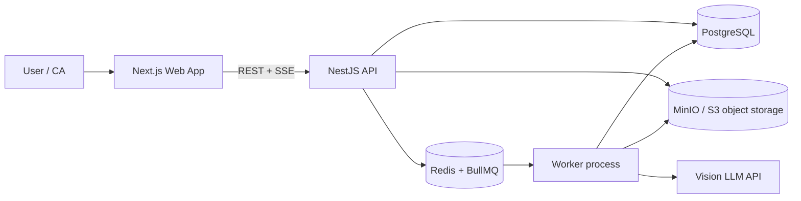
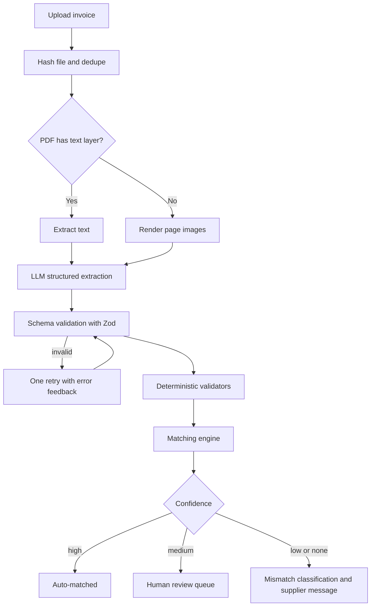
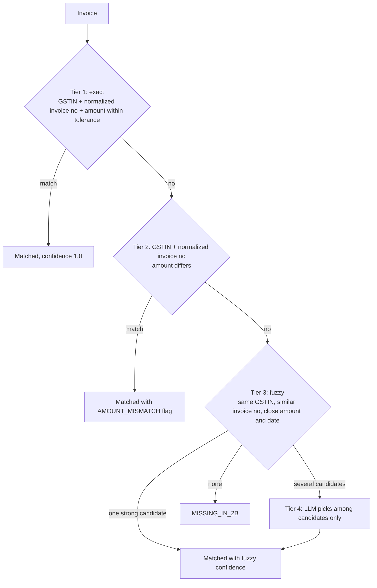
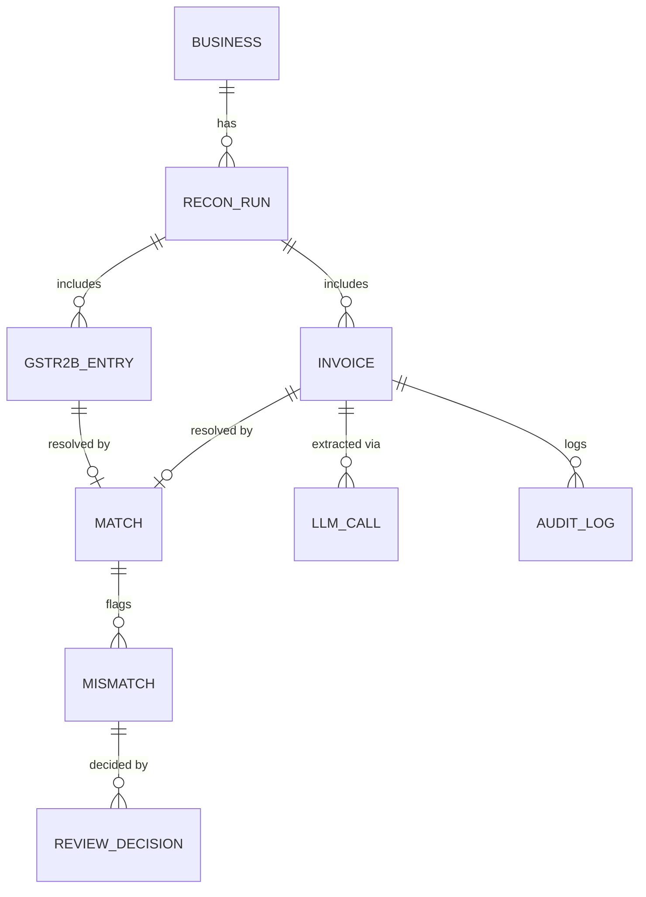

# GSTLens

**AI-assisted GST invoice reconciliation for Indian small businesses and the CAs who serve them.**

Upload purchase invoices (PDFs or phone photos) and your GSTR-2B file. GSTLens extracts the invoice data, validates it with deterministic code, matches it against GSTR-2B, explains every mismatch, and drafts the follow-up message to the supplier.


> **Demo:** `[ADD 2-MINUTE DEMO GIF HERE]` | **Live app:** `[ADD LINK]` | **Video walkthrough:** `[ADD LINK]`

---

## The problem

Every month, a business that claims Input Tax Credit (ITC) has to check that each purchase invoice it received appears correctly in the GSTR-2B statement generated by the GST portal. Invoices arrive as PDFs, phone photos and WhatsApp forwards, so accountants re-type them into spreadsheets and match them by hand, line by line.

When an invoice is missing from the supplier's filing, or the amount, GSTIN or tax split is wrong, the credit can be delayed or lost. Finding these mismatches is slow and error-prone, and chasing suppliers about them is its own chore.

## What GSTLens does

1. **Ingests** invoices (PDF, JPG, PNG) and the GSTR-2B JSON downloaded from the GST portal.
2. **Extracts** supplier GSTIN, invoice number, date, taxable value, CGST, SGST, IGST, cess and total using a vision-capable LLM.
3. **Validates deterministically**: GSTIN format and checksum, tax-rate arithmetic, intra-state vs inter-state tax split, total consistency.
4. **Matches** invoices to GSTR-2B entries using layered logic: exact rules, then fuzzy matching, then an LLM only for ambiguous leftovers.
5. **Classifies mismatches**: missing in GSTR-2B, amount difference, tax split error, GSTIN error, duplicate, period mismatch.
6. **Drafts supplier follow-ups** (email/WhatsApp text) for each mismatch, ready to review and send.
7. **Routes uncertain cases to a human review queue**, and logs every decision.

### What it deliberately does not do

- It does not file returns, claim ITC, or give tax advice. It flags and explains; a human decides.
- The LLM never performs arithmetic or makes the final call on money. See design principles.

---

## Design principles

| Principle | What it means in the code |
|---|---|
| **LLM for reading, code for money** | The model turns messy documents into structured fields. All tax math, checksums and amount comparisons are plain, unit-tested code. |
| **Cheapest correct path first** | Text-layer PDFs skip vision. Exact matches skip fuzzy logic. Fuzzy matches skip the LLM. The LLM is the last resort. |
| **Never guess** | If a field is unreadable, the extractor returns `null` with a low confidence score instead of inventing a value. |
| **Human in the loop** | Anything below the confidence threshold goes to a review queue. Nothing is silently auto-accepted. |
| **Everything is auditable** | Every extraction, match decision and human override is stored with inputs, outputs and timestamps. |
| **Measure, don't claim** | Accuracy and cost numbers in this README come from a labeled test set (see [Evaluation](#evaluation)). |

---

## Architecture

### System overview



| Component | Responsibility |
|---|---|
| **Web app (Next.js)** | Upload, progress, reconciliation results, mismatch details, review queue, supplier message drafts |
| **API (NestJS)** | Auth, uploads, run management, results endpoints, review decisions, progress streaming |
| **Worker (NestJS standalone app)** | Runs pipeline jobs: preprocessing, extraction, validation, matching, report generation |
| **PostgreSQL** | Businesses, runs, invoices, GSTR-2B entries, matches, mismatches, audit log, LLM call log |
| **Redis + BullMQ** | Job queues with retries, backoff, concurrency limits and rate limiting for LLM calls |
| **MinIO / S3** | Original files and rendered page images |
| **LLM API** | Structured extraction (tool-use / JSON schema), fuzzy-match tie-breaking, message drafting |

A modular monolith with one API process and one worker process is intentional. It is easier to run, test and explain than a set of microservices, and the module boundaries make splitting later straightforward.

### Processing pipeline



Each stage is its own BullMQ job, so a failure at one stage retries only that stage. Jobs are idempotent: the file hash plus run ID is the idempotency key, so re-uploading the same invoice never creates duplicates.

### Queues

| Queue | Concurrency | Notes |
|---|---|---|
| `preprocess` | high | PDF text detection, page rendering, image cleanup |
| `extract` | limited by LLM rate limit | Retries with exponential backoff, cache by file hash |
| `validate` | high | Pure CPU, no external calls |
| `match` | one per run | Runs after all invoices in a run are extracted |
| `report` | low | Mismatch classification, message drafting |

---

## Extraction

The extractor uses structured output (tool-use or JSON schema) at temperature 0 and validates the result with a Zod schema. If validation fails, it retries once with the validation error included in the prompt.

```json
{
  "supplier_name": "Sharma Traders",
  "supplier_gstin": "27ABCDE1234F1Z5",
  "invoice_number": "INV/23-24/0045",
  "invoice_date": "2024-01-15",
  "taxable_value": 100000.00,
  "cgst": 9000.00,
  "sgst": 9000.00,
  "igst": 0.00,
  "cess": 0.00,
  "total_value": 118000.00,
  "confidence": {
    "supplier_gstin": 0.98,
    "invoice_number": 0.95,
    "taxable_value": 0.99
  }
}
```

Implementation rules:

- Money is stored as **integer paise** (`BigInt`), never floats.
- Missing or unreadable fields are `null`, never guessed.
- Every LLM call is logged with model, tokens, latency, cost and the raw response, so any extraction can be replayed and debugged.

---

## Deterministic validation

All of this is plain TypeScript with unit tests, no LLM involved.

| Check | Logic |
|---|---|
| **GSTIN format** | 15 characters: 2-digit state code, 10-character PAN, entity number, `Z`, checksum character |
| **GSTIN checksum** | Base-36 weighted checksum over the first 14 characters, compared to the 15th |
| **Tax arithmetic** | `taxable_value × rate` matches tax amounts within a ₹1 rounding tolerance |
| **Tax split** | Same-state supply expects CGST + SGST (equal); inter-state expects IGST. State comes from GSTIN prefix vs the buyer's state |
| **Total consistency** | `total ≈ taxable + CGST + SGST + IGST + cess` within tolerance |
| **Date sanity** | Invoice date is valid and not in the future |

Each failed check becomes a structured flag attached to the invoice, which feeds the review queue and the mismatch report.

---

## Matching engine

Matching runs in tiers. An invoice stops at the first tier that resolves it.



**Invoice number normalization** handles the realistic mess: case, spaces and separators, leading zeros, and financial-year segments, so `INV/23-24/0045`, `inv-0045` and `45` can resolve to the same key.

**Tier 4 safety:** the LLM only chooses among candidate GSTR-2B rows supplied by code, or answers "none". It cannot introduce a match that code did not propose.

**Confidence thresholds (tunable in config):**

| Confidence | Action |
|---|---|
| ≥ 0.90 | Auto-matched |
| 0.60 to 0.90 | Human review queue |
| < 0.60 | Treated as unmatched |

### Mismatch categories

| Category | Meaning |
|---|---|
| `MISSING_IN_2B` | Invoice exists in books but not in GSTR-2B (supplier may not have filed) |
| `MISSING_IN_BOOKS` | GSTR-2B entry with no matching purchase invoice |
| `AMOUNT_MISMATCH` | Matched, but taxable value or tax amounts differ beyond tolerance |
| `TAX_SPLIT_MISMATCH` | IGST vs CGST/SGST does not fit the place of supply |
| `GSTIN_MISMATCH` | Invoice number and amount match a 2B row under a different GSTIN |
| `DUPLICATE` | Same supplier, invoice number and amount appears more than once |
| `PERIOD_MISMATCH` | Invoice appears in a different return period |
| `INVALID_GSTIN` | GSTIN fails format or checksum validation |

Each mismatch carries the evidence (both records side by side), a plain-language explanation, a suggested action and a drafted supplier message.

---

## Data model



| Table | Key fields |
|---|---|
| `business` | id, name, gstin, state_code |
| `recon_run` | id, business_id, period (e.g. 2024-01), status, created_at |
| `invoice` | id, run_id, file_hash, file_key, extracted fields, confidences, validation_flags, status |
| `gstr2b_entry` | id, run_id, supplier_gstin, supplier_name, invoice_number, invoice_date, taxable_value, cgst, sgst, igst, cess, total |
| `match` | id, invoice_id, gstr2b_entry_id, tier, confidence |
| `mismatch` | id, run_id, invoice_id, gstr2b_entry_id, category, explanation, suggested_action, draft_message |
| `review_decision` | id, mismatch_id, user_id, decision, note, decided_at |
| `llm_call` | id, invoice_id, purpose, model, tokens_in, tokens_out, cost, latency_ms, raw_response |
| `audit_log` | id, entity, entity_id, action, actor, payload, created_at |

The GSTR-2B JSON structure should be confirmed against a real sample downloaded from the GST portal. The parser normalizes it into the `gstr2b_entry` shape so the rest of the system is independent of the portal's format.

---

## API (planned)

| Method | Endpoint | Purpose |
|---|---|---|
| `POST` | `/auth/login` | Authenticate |
| `POST` | `/businesses` | Create a business profile |
| `POST` | `/runs` | Start a reconciliation run for a period |
| `POST` | `/runs/:id/invoices` | Upload invoice files (multipart) |
| `POST` | `/runs/:id/gstr2b` | Upload the GSTR-2B JSON |
| `POST` | `/runs/:id/start` | Begin processing |
| `GET` | `/runs/:id` | Run status and summary |
| `GET` | `/runs/:id/events` | Progress stream (SSE) |
| `GET` | `/runs/:id/matches` | Matched invoices |
| `GET` | `/runs/:id/mismatches` | Mismatches, filterable by category |
| `GET` | `/runs/:id/review-queue` | Items needing human review |
| `POST` | `/mismatches/:id/decision` | Accept, reject or correct a match |
| `GET` | `/runs/:id/export` | Export report as CSV/Excel |

---

## Tech stack

| Layer | Choice | Why |
|---|---|---|
| Frontend | Next.js, TypeScript, Tailwind, TanStack Query | Fast to build, easy to deploy |
| Backend | NestJS, TypeScript | Modules, DI, easy testing |
| Queue | BullMQ + Redis | Retries, backoff, rate limiting, job visibility |
| Database | PostgreSQL + Prisma | Relational data, migrations, types |
| Storage | MinIO locally, S3-compatible in production | Original files and page images |
| LLM | Claude (vision + tool-use), behind a provider interface | Structured extraction; swappable |
| Validation | Zod | Schema validation for LLM output and API input |
| Fuzzy matching | Jaro-Winkler / Levenshtein library | Invoice-number similarity |
| Testing | Jest, Playwright | Unit tests for validators, e2e for the main flow |
| DevOps | Docker Compose, GitHub Actions | One-command local setup, CI on every push |

---

## Project structure

```text
gstlens/
├── apps/
│   ├── api/                  # NestJS HTTP API
│   ├── worker/               # NestJS standalone app running BullMQ processors
│   └── web/                  # Next.js frontend
├── packages/
│   ├── core/                 # Pure logic: validators, normalizers, matching engine (no I/O)
│   ├── llm/                  # Provider interface, prompts, schemas, cost tracking
│   └── shared/               # Shared types and Zod schemas
├── eval/
│   ├── dataset/              # Labeled invoices and expected outputs
│   ├── generate/             # Synthetic invoice generator
│   └── run-eval.ts           # Computes accuracy, precision/recall, cost
├── docs/
│   └── images/               # Diagrams and screenshots
├── docker-compose.yml
├── .env.example
└── README.md
```

Keeping `packages/core` free of I/O means the most important logic (validators and matching) is fast to unit test and easy to reuse in the evaluation harness.

---

## Getting started

### Prerequisites

- Node.js 20+
- Docker and Docker Compose
- An LLM API key (Anthropic)

### Setup

```bash
git clone https://github.com/<your-username>/gstlens.git
cd gstlens
cp .env.example .env        # add your API key
docker compose up -d        # Postgres, Redis, MinIO
npm install
npx prisma migrate dev
npm run dev                 # starts api, worker and web
```

Open `http://localhost:3000`.

### Environment variables

| Variable | Description |
|---|---|
| `DATABASE_URL` | PostgreSQL connection string |
| `REDIS_URL` | Redis connection string |
| `S3_ENDPOINT`, `S3_BUCKET`, `S3_ACCESS_KEY`, `S3_SECRET_KEY` | Object storage |
| `ANTHROPIC_API_KEY` | LLM provider key |
| `LLM_MODEL_EXTRACT` | Model used for extraction |
| `AMOUNT_TOLERANCE_PAISE` | Rounding tolerance for amount comparison (default `100`) |
| `MATCH_AUTO_THRESHOLD` | Auto-accept confidence (default `0.90`) |
| `MATCH_REVIEW_THRESHOLD` | Review-queue lower bound (default `0.60`) |
| `JWT_SECRET` | Auth token signing |

### Try it with sample data

```bash
npm run seed:sample         # loads synthetic invoices + a matching GSTR-2B file
```

---

## Evaluation

The goal is to prove the system works, not just claim it.

### Dataset

- **100 to 150 invoices** covering printed PDFs, scanned PDFs, phone photos, and multiple layouts.
- A mix of **synthetic invoices** (generated from templates with known ground truth) and **anonymized real invoices** (with supplier details masked, used with permission).
- A matching **GSTR-2B file** with deliberately injected issues: missing invoices, amount changes, wrong GSTINs, duplicates, tax-split errors, format variations in invoice numbers.
- Every invoice has hand-verified ground truth for all fields and the expected match outcome.

### Metrics

| Area | Metric |
|---|---|
| Extraction | Field-level exact-match accuracy, reported per field (GSTIN, invoice no, date, amounts) |
| Validation | Detection rate of injected arithmetic and GSTIN errors |
| Matching | Precision, recall and F1 of matches; correct mismatch-category rate |
| Efficiency | % of invoices resolved at each tier; % that reach the LLM |
| Cost | Average LLM cost per invoice and per run |
| Speed | Median and p95 processing time per invoice |
| Human effort | % of invoices sent to the review queue |

### Baselines

Compare against a **rules-only baseline** (OCR + regex extraction, exact and fuzzy matching, no LLM) so the value of the LLM is visible rather than assumed. Also compare **LLM-for-everything** against the tiered approach to quantify the cost savings.

### Results

> Fill these in only with numbers measured by `eval/run-eval.ts`. Do not publish estimates.

| Metric | Rules-only baseline | GSTLens |
|---|---|---|
| Field extraction accuracy (overall) | TBD | TBD |
| GSTIN extraction accuracy | TBD | TBD |
| Match precision | TBD | TBD |
| Match recall | TBD | TBD |
| Mismatch category accuracy | TBD | TBD |
| Avg LLM cost per invoice | n/a | TBD |
| % invoices reaching LLM fallback in matching | n/a | TBD |
| Median processing time per invoice | TBD | TBD |

### Pilot

`[Describe your real-user trial here: who (anonymized, e.g. "a practicing CA in Mizoram"), how many invoices, time saved, and one honest quote or observation.]`

---

## Cost and performance controls

- **Text-layer shortcut:** PDFs with embedded text are sent as text, not images, which is cheaper and often more accurate.
- **Caching:** extraction results are cached by file hash, so re-runs cost nothing.
- **Tiered matching:** the LLM is invoked only for ambiguous matches, not for every invoice.
- **Model routing:** a smaller model handles clean documents; a larger one is used only when confidence is low.
- **Rate limiting and backoff:** BullMQ limits keep the pipeline within provider limits and recover from transient failures.
- **Per-run budget:** a configurable spend cap stops a run before it gets expensive.

---

## Security and privacy

Invoices contain business-sensitive data, so the project treats them carefully.

- Uploaded files are stored in private object storage and served through short-lived signed URLs.
- Passwords are hashed; auth uses short-lived JWTs with refresh tokens.
- Users can only access their own businesses and runs (enforced in the API layer and tested).
- Prompts are built from the minimum data needed, and raw LLM logs can be disabled or purged per run.
- Secrets live in environment variables, never in the repo.
- Real invoices used for evaluation are anonymized before they are committed or shared.

---

## Roadmap and status

Update this checklist honestly as you build. A truthful checklist is more credible than a long feature list.

**Phase 1: Foundations (week 1)**
- [ ] Repo, Docker Compose, CI
- [ ] GSTR-2B parser and normalizer
- [ ] GSTIN format and checksum validator
- [ ] Tax arithmetic and tax-split validators, with unit tests

**Phase 2: Extraction (week 2)**
- [ ] File upload and object storage
- [ ] PDF text-layer detection and page rendering
- [ ] LLM extraction with schema validation and retry
- [ ] BullMQ pipeline with idempotent jobs

**Phase 3: Matching (week 3)**
- [ ] Invoice number normalization
- [ ] Tier 1 and 2 exact matching
- [ ] Tier 3 fuzzy matching with confidence scoring
- [ ] Tier 4 LLM tie-breaker (candidates only)
- [ ] Mismatch classification

**Phase 4: Product (week 4)**
- [ ] Next.js upload and results UI
- [ ] Mismatch detail view with side-by-side evidence
- [ ] Human review queue and decisions
- [ ] Supplier message drafts, CSV/Excel export

**Phase 5: Proof (week 5)**
- [ ] Labeled dataset and synthetic generator
- [ ] Evaluation harness and baseline comparison
- [ ] Real-user pilot
- [ ] Deployment, demo GIF, final README numbers

**Later**
- [ ] GSTR-2A support
- [ ] Multi-business and multi-user (CA firm) workspaces
- [ ] Tally / Zoho Books import
- [ ] Supplier follow-up tracking

---

## Limitations and disclaimer

- GSTLens is a reconciliation aid. It is **not** tax, legal or accounting advice, and it does not file returns or claim credit.
- LLM extraction can be wrong on poor-quality images. The confidence scores and review queue exist for this reason, and results should always be checked before acting on them.
- GST rules and portal formats change. The parser and validators should be re-checked against current official documentation.
- Evaluation numbers apply to the dataset described above and may not generalize to every invoice layout.

---

## Contributing

Issues and pull requests are welcome. Please run `npm test` and `npm run lint` before submitting.

## License

MIT

## Author

**[Your Name]** | [LinkedIn](#) | [Email](#)

If you are a CA or accountant willing to try this on anonymized data, I would love your feedback.
